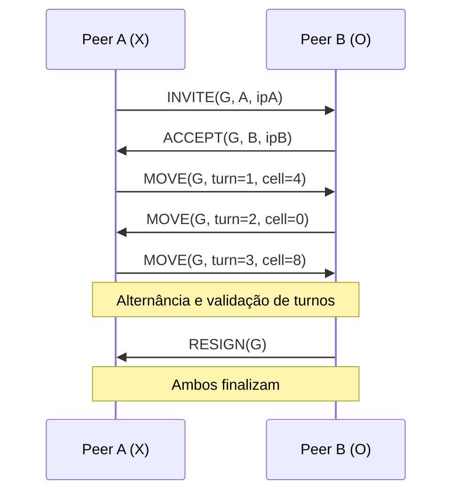

# Protocolo JVD/1 — Jogo da Velha distribuído para Pitiupi

## 1. Objetivo

Permitir uma partida de Jogo da Velha entre **dois peers** do Pitiupi, sem servidor de aplicação. Um peer inicia a sessão, o outro aceita, e os dois reproduzem a mesma sequência de jogadas de forma determinística. O protocolo também permite rejeição e desistência. O estado do tabuleiro reside **nos dois computadores**.

## 2. Modelo de comunicação

- **Topologia:** ponto a ponto, unicast (um emissor → um IPv4 de destino).
- **Transporte:** **TCP** público da ferramenta Pitiupi. Não usa UDP e não cria um `Socket` próprio.
- **Porta:** configurada no login da ferramenta, **a mesma para os dois peers** (ex.: `5000`). Não é escolhida pelo plugin.
- **Endereçamento:** IPv4 fornecido na interface do plugin e IPv4 local obtido com `LocalNetworkInfo.bestLocalIpv4()`.
- **Encaminhamento:** `ConnectionManager.sendTcpAsync(message, destinoIp, listener)` realiza a abertura/envio de modo assíncrono. O núcleo repassa a mensagem recebida ao `receiveMessage(Message)` do plugin após consultar `getMessages()`.
- **Serialização:** `GameMessage` herda de `pitiupi.models.Messages.Message` e implementa o formato de objetos `java.io.Serializable`, não JSON. O Pitiupi encapsula o objeto em um **frame de 4 bytes de tamanho (int) + N bytes serializados**. Os peers devem usar classes Java compatíveis.
- **Identificação da partida:** `gameId` UUID aleatório, único por convite.
- **Identificação do peer:** `senderId` UUID aleatório por instância do plugin, mantido durante a execução.
- **Identificação do plugin:** `br.edu.ufsj.pitiupi.jogodavelha`.

**Diagrama do envio:**

```text
Peer A                       Pitiupi A                 Pitiupi B                         Peer B
Jogo da Velha A                   |                         |                          Jogo da Velha B
    |-- GameMessage ------------>|                         |                                |
    |                            |-- TCP unicast: IP_B ---->|                                |
    |                            |    [int N][N bytes]      |-- desserializa e encaminha -->|
    |                            |                         |                                |
    |<---------------------------|<--------- resposta TCP --------------------- GameMessage --|
```

Não confunda protocolo **JVD/1 (lógica do jogo)** com TCP (transporte) nem com o protocolo interno do Pitiupi (enquadramento e serialização).

## 3. Formato lógico da mensagem

Existe **uma classe serializável** `pitiupi.jogodavelha.protocol.GameMessage`. Não há offsets fixos por campo no payload: os campos são codificados pelo mecanismo de serialização Java e transportados pelo Pitiupi.

| Campo | Tipo Java | Descrição / regra |
|---|---|---|
| `version` | `int` | Versão do protocolo; valor **1** em todos os envios. |
| `kind` | `enum Kind` | `INVITE`, `ACCEPT`, `DECLINE`, `MOVE`, `RESIGN`. |
| `gameId` | `String` UUID | Identifica univocamente a partida (gerado pelo convidador). |
| `senderId` | `String` UUID | Identifica a instância que envia (não equivale a autenticação). |
| `senderName` | `String` | Nome visível no Pitiupi, com 1–40 caracteres. |
| `senderIp` | `String` | IPv4 do emissor; usado para encaminhar a resposta e verificar consistência lógica. |
| `turn` | `int` | Número da jogada em `MOVE`: **1 a 9**. Nos controles `INVITE`, `ACCEPT`, `DECLINE`: **0**; em `RESIGN`, o número de jogadas realizadas. |
| `cell` | `int` | Índice da casa (0–8) para `MOVE`; **-1** nos controles. |

O cabeçalho lógico é a dupla `version` + `kind`; o contexto é `gameId` + `senderId` + `senderIp`; o conteúdo específico vem em `turn` + `cell`.

### Numeração do tabuleiro

```text
       Colunas
       0   1   2
     +---+---+---+
  0  | 0 | 1 | 2 |
     +---+---+---+
  1  | 3 | 4 | 5 |
     +---+---+---+
  2  | 6 | 7 | 8 |
     +---+---+---+
```

## 4. Tipos de mensagem

| Tipo | Emissor → destinatário | Pré-condição / efeito |
|---|---|---|
| `INVITE` | A → B | A cria UUID `gameId`, assume `X`, salva `IP_B`, entra em `OUTGOING`. B recebe e vai para `INCOMING`, ou rejeita automaticamente se estiver ocupado. |
| `ACCEPT` | B → A | B aceita, assume `O` e entra em `PLAYING`. A reconhece a sessão/peer e entra em `PLAYING`. `X` joga primeiro. |
| `DECLINE` | B → A | Rejeita convite pendente. A e B encerram aquela tentativa; outro convite pode começar. |
| `MOVE` | jogador da vez → outro | Informa casa `cell` e número sequencial `turn`. Os dois replicam a jogada. |
| `RESIGN` | um jogador → outro | Indica desistência/encerramento antes do fim. Ambos deixam `PLAYING` ou `OUTGOING` e registram o encerramento. |

**Vitória e empate não precisam de `GAME_OVER`:** ambos computam o vencedor com as mesmas oito trincas vencedoras e sabem que o tabuleiro cheio sem vencedor equivale a empate. Isso evita um pacote extra; o resultado só será consistente se todos os `MOVE` anteriores tiverem sido entregues.

## 5. Máquina de estados

```text
IDLE --criar INVITE--> OUTGOING --receber ACCEPT--> PLAYING --vitoria/empate--> FINISHED
                               \--receber DECLINE--------------> FINISHED
              ^
              | (novo convite, após FINISHED)
FINISHED -----+

IDLE/FINISHED --receber INVITE--> INCOMING --aceitar--> PLAYING
                                     \--recusar-------> FINISHED

PLAYING/OUTGOING --RESIGN enviado/recebido--> FINISHED
PLAYING/OUTGOING --erro de envio TCP--------> FINISHED (local)
```

Há **somente uma partida atual** por peer. Em `PLAYING`, as fases não podem voltar a `OUTGOING`; uma nova partida exige finalizar a anterior. Enquanto ocupado, um `INVITE` de outra sessão recebe `DECLINE` automático.

## 6. Sequência completa de execução

1. A (nome Ana, IP `192.168.1.10`) convida B (nome Bruno, IP `192.168.1.20`): `INVITE {gameId=G, senderId=A, senderIp=192.168.1.10, turn=0, cell=-1}`.
2. B recebe a mensagem e mostra um diálogo. Ao clicar **Sim**, B responde `ACCEPT {gameId=G, senderId=B, senderIp=192.168.1.20, turn=0, cell=-1}`.
3. A entra em `PLAYING`, símbolo `X`, e clica na casa central. A atualiza seu tabuleiro e envia `MOVE {gameId=G, senderId=A, turn=1, cell=4}`.
4. B valida partida, identidade, IP, ordem e casa livre; aplica `X` na casa `4` e habilita sua vez (`O`).
5. B responde com `MOVE {gameId=G, senderId=B, turn=2, cell=0}`. A valida e aplica `O` na casa `0`.
6. As jogadas seguem com números 3, 4, ... até a vitória, empate ou `RESIGN`.



## 7. Regras de validação

1. Rejeitar mensagens cujo `version` não seja `1`, cujo `kind` seja desconhecido ou cujos UUIDs/IPv4 estejam malformados.
2. Ignorar mensagens cujo `senderId` seja o próprio UUID da instância (evita autoentrega).
3. Para um evento de sessão existente, exigir igualdade de `gameId` e `senderIp` e, após a resposta inicial, de `senderId`.
4. Em `MOVE`, exigir fase `PLAYING`, turno exatamente `moves + 1`, casa entre 0 e 8, casa vazia e remetente associado ao símbolo que tem a vez.
5. Ignorar mensagens duplicadas, atrasadas, de sessão antiga ou fora de ordem. Um MOVE inválido não altera estado e **não consome o turno**.
6. Após cada jogada, verificar as oito linhas de vitória; caso contrário, se nove casas estão cheias, marcar empate.
7. Somente permitir envio de novo `INVITE` quando a fase é `IDLE` ou `FINISHED`.

## 8. Entrega, falhas e segurança

**TCP fornece** fluxo ordenado e retransmissão de bytes enquanto a conexão está íntegra. O Pitiupi delimita objetos por prefixo de tamanho e usa a conexão pública para o IP. Por isso, JVD/1 não implementa número de sequência de pacotes nem ACK por jogada; `turn` é um **número de jogada da aplicação** para detectar inconsistências semânticas. A chamada `sendTcpAsync` evita bloquear a interface por uma conexão lenta. O callback de erro encerra a partida **localmente** e informa o problema, mas não garante que o outro peer tenha recebido o último envio.

**Falhas não cobertas:** não há reconexão com restauração de tabuleiro, persistência entre reinicializações, timeout automático do convite ou confirmação de resultado após queda da conexão. `RESIGN` só chega se a rede estiver disponível. Em redes reais, TCP não fornece confirmação de que a aplicação remota processou a mensagem (somente que o envio foi aceito pela camada de rede do núcleo).

**Segurança:** não há TLS, autenticação, autorização ou prova de origem. O IP no payload é **autodeclarado**. Um adversário na mesma rede pode forjar mensagens ou explorar as propriedades da desserialização Java; use apenas em redes e com JARs confiáveis, conforme a documentação do Pitiupi. A validação é lógica, não uma defesa criptográfica.

**Compatibilidade:** o valor `version = 1` e `serialVersionUID = 1L` identificam a representação desta classe. Instale a mesma versão do JAR em ambos os peers. Não há negociação de versões.

## 9. Responsabilidades do código

- `GameMessage`: envelope do protocolo e dados serializáveis.
- `GameSession`: estado da partida, transições, verificação de casas, turnos, remetentes, vitória e empate.
- `TicTacToePlugin`: registro SPI, ponto de entrada do Pitiupi, `receiveMessage`, `sendTcpAsync`, execução de eventos na EDT, convite modal e callbacks de falha.
- `GamePanel`: visualização 3×3, campos e botões Swing. Não implementa regras de jogo nem faz rede.

## 10. Cenários de teste exigidos

- Convite aceito e recusa explícita.
- Alternância X/O, vitória horizontal, empate, desistência.
- Duplicação de `MOVE` não altera a contagem.
- Tentativa de `MOVE` com turno incorreto, remetente incorreto ou IP divergente é ignorada.
- Um terceiro peer tentando convidar durante a partida recebe recusa automática.
- Serialização/desserialização Java mantém os campos.

Os cenários automatizados estão em `test/java/pitiupi/jogodavelha/GameSessionTest.java` (`ant test`). Para testar rede e integração, inicie o Pitiupi em dois computadores com o plugin instalado.
